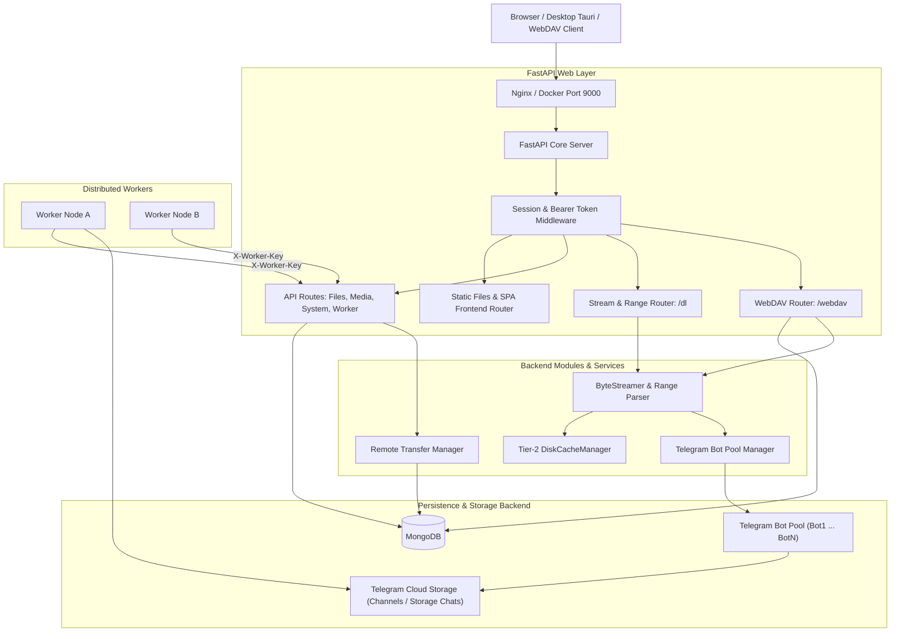
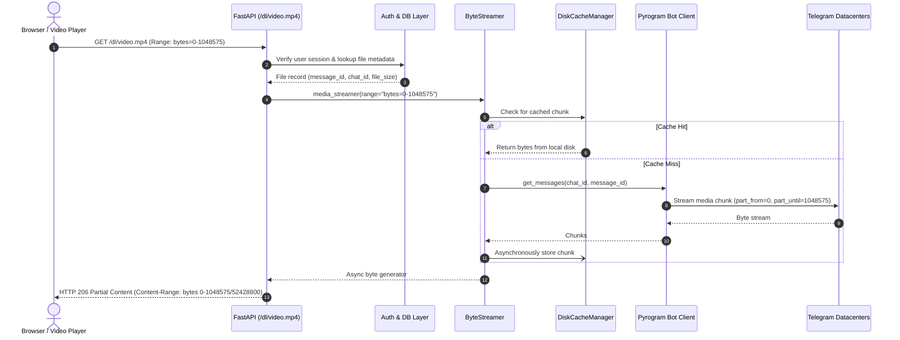

# TeleStore Architecture & Request Flow

This document details the architectural design, request lifecycles, and component interactions of the TeleStore system.

---

## 1. High-Level Architecture

TeleStore is a hybrid cloud storage and media server that uses Telegram channels as an infinite, cost-effective object storage backend while providing a modern web drive interface, WebDAV access, and distributed remote transfer workers.



---

## 2. Core Components

### A. Frontend Single-Page Application (SPA)
- **Tech Stack**: React 18, Vite, Tailwind CSS, Lucide React icons, Vitest.
- **Delivery**: Static build in `frontend/dist/`, served by FastAPI via fallback routing.
- **Capabilities**: Multi-file explorer, drag-and-drop upload, video/audio player with seeking, photo viewer, document viewer, remote transfer monitor, cloud storage connectors.

### B. FastAPI Application Server (`telestore/api/app.py`)
- **Routing & Endpoints**:
  - `/auth`: Local password authentication, Google OAuth login.
  - `/files`: Hierarchical folder browsing, pagination, renaming, deletion, tagging, and chunked uploads.
  - `/dl`: High-throughput media streaming and file downloads.
  - `/system`: System health, Telegram bot pool workloads, GitHub auto-update webhooks.
  - `/api/worker`: Distributed worker task claiming, progress reporting, and completion.
  - `/webdav`: WebDAV protocol support for external clients (Mixplorer, rclone, native OS file managers).
- **Security & Session Management**:
  - Encrypted Starlette session cookies (`SESSION_SECRET_KEY`).
  - Scrypt password hashing with backward-compatible auto-upgrade for legacy SHA-256 hashes (`telestore/utils/passwords.py`).
  - Strict header authentication (`X-Worker-Key`) for distributed worker nodes.
  - HMAC-SHA256 signature verification for GitHub auto-update webhooks (`X-Hub-Signature-256`).

### C. Telegram Bot Pool Manager
- **Multi-Client Architecture**: Maintains up to 20 concurrent Pyrogram bot clients (`TOKEN0` ... `TOKEN19`).
- **Load Balancing**: Distributes download and stream chunk requests across bots to avoid Telegram API rate limits and maximize bandwidth.
- **Workload Tracking**: Dynamically reports per-bot active download streams via `/system/workloads`.

### D. MongoDB Layer (`telestore/db`)
- **Collections**:
  - `Users`: User accounts, hashed passwords, verified Telegram identities, active tokens.
  - `Files`: File metadata, original filenames, sizes, MIME types, Telegram `file_unique_id`, `chat_id`, `message_id`, folder hierarchy, trash state.
  - `Settings`: Application configuration and user preferences.
  - `RemoteTransfers`: Tasks for URL downloads, folder transfers, and worker claims.
  - `CloudAccounts`: Connected Google Drive / cloud storage credentials.

---

## Code Layout

```
telestore/                 Python backend package — run with `python -m telestore`
├── __main__.py            entry point: starts the bot pool, which starts the web server
├── config/                settings.py (env vars, required secrets), strings, keyboards, links
├── api/                   FastAPI app
│   ├── app.py             app factory: middleware, routers, static frontend
│   ├── server.py          uvicorn server manager used by the bot pool
│   ├── state.py           in-memory auth tokens, stale-upload cleanup
│   └── routes/            one module per area (auth, folders, stream, media, vault, cloud,
│       ├── files/         …) — larger areas are packages:
│       │                  common (router), browse, manage, upload
│       └── webdav/        common, dispatcher, propfind, browser (HTML view), transfer, operations
├── services/              business logic: streaming, caching, archives, torrents, Google Drive,
│   └── remote_transfer_manager/   helpers, pipeline (stream writer), manager (queue + workers)
├── security/              credentials, session/token auth, Google sign-in
├── db/                    client.py (MongoDB connection) + repositories/ (users, files, settings, …)
├── telegram/              bot.py, user.py, plugins/ (bot commands), user_plugins/
└── utils/                 passwords (scrypt), text helpers
d4rk/                      vendored bot-pool/logging framework (kept as-is)
frontend/src/              React app — app/, components/{ui,layout,feedback}, features/<area>/,
                           shared hooks/, lib/, contexts/, styles/
worker/                    standalone remote worker (runs on other VMs)
tests/                     pytest suite (no .env, network or database needed)
```

## 3. End-to-End Request Flows

### 1. Browser Navigation & API Request Flow
1. **User Request**: Browser loads `https://host/files?path=/Documents`.
2. **Session / Auth Validation**:
   - `require_auth` inspects the request session cookie or `Authorization: Bearer <token>` header.
   - User identity and permissions are retrieved from MongoDB (`database.Users`).
3. **Route Handling**: `get_all_files_route` queries `database.Files` for files matching `path="/Documents"` and `owner_id`.
4. **JSON Response**: FastAPI serializes file records with pagination metadata and returns HTTP 200.

### 2. Media Streaming with HTTP Range Requests


### 3. Distributed Remote Worker Task Flow
1. **Task Enqueue**: User submits a direct download URL or cloud transfer in the web UI. A document is created in MongoDB `RemoteTransfers` with status `"queued"`.
2. **Worker Polling / Claim**: External worker sends `POST /api/worker/claim-task` with `X-Worker-Key`.
3. **Atomic Claim**: Server finds the oldest queued task, updates status to `"in_progress"`, assigns `worker_id`, and returns the task payload.
4. **Execution & Progress**:
   - Worker downloads file from source (HTTP/aria2/Google Drive).
   - Worker uploads file chunks to Telegram storage channel using worker's own Telegram bot.
   - Worker posts periodic progress to `POST /api/worker/update-progress`.
5. **Completion**:
   - Worker finishes upload, records Telegram `file_id`, `message_id`, `chat_id`.
   - Worker calls `POST /api/worker/complete-task` with `X-Worker-Key`.
   - Server writes file metadata into `Files` collection and marks transfer `"completed"`.

### 4. WebDAV Access Flow
1. **Client Connection**: WebDAV client (Mixplorer, Cyberduck, OS mount) connects to `/webdav`.
2. **Authentication**: HTTP Basic Auth is validated against `database.Users` (or fallback admin).
3. **Directory Browsing**: `PROPFIND` translates WebDAV XML directory queries into MongoDB folder/file lookups.
4. **File Operations**:
   - `GET`: Streams file from Telegram via `ByteStreamer`.
   - `PUT`: Buffers upload to disk, uploads to Telegram via bot pool, registers in MongoDB.
   - `MKCOL` / `MOVE` / `DELETE`: Translates directly to folder creation, renaming, and soft-delete/trash in MongoDB.
